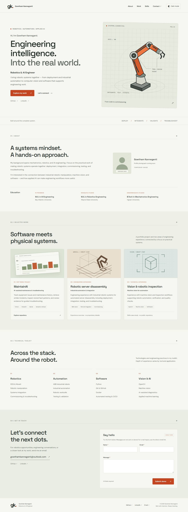

# Gowtham Kanneganti — Robotics & AI Engineer

I work at the intersection of robotics deployment, industrial automation, systems integration, computer vision, and applied AI. This portfolio brings together a few examples of my work and the engineering skills I use to take systems from development into real-world operation.

**[View my portfolio](https://a5ura.github.io/robotics-portfolio/)** · [GitHub](https://github.com/a5ura) · [LinkedIn](https://www.linkedin.com/in/gowtham-c-kanneganti/) · [Email](mailto:gowthamkanneganti@outlook.com)



[View the mobile layout](docs/screenshots/portfolio-mobile.png)

## Featured work

**[MaintainAI](https://github.com/a5ura/MaintainAI)** — An AI-assisted equipment maintenance and troubleshooting project. It brings together issue tracking, maintenance history, retrieval of similar incidents, and guided investigation of equipment problems.

**Robotic server disassembly and automation** — Engineering experience with industrial robotic workcells, including deployment, integration, commissioning, testing, and troubleshooting.

**Computer vision and robotic inspection** — Machine-vision and inspection workflows used to support automated verification and quality checks.

The latter two cards describe engineering experience, not public source-code projects. Their illustrations are conceptual rather than photographs of deployed systems.

## About the website

This is a responsive, single-page portfolio built with HTML, CSS, and JavaScript. It includes:

- An introduction, professional background, education, and technical skills.
- Three featured project/experience cards and links to my professional profiles.
- Light and dark themes, with the selected preference saved in the browser.
- A contact-form **demonstration** with input validation and a confirmation message.
- Keyboard-friendly navigation, semantic page structure, and reduced-motion support.

**The contact form does not send or save messages.** For an actual inquiry, use the [email link](mailto:gowthamkanneganti@outlook.com).

## Run locally

You'll need Node.js 22 or newer and npm.

```powershell
git clone https://github.com/a5ura/robotics-portfolio.git
cd robotics-portfolio
npm ci
npm run dev
```

Then open **http://127.0.0.1:4173/**. The application itself is static; Node.js is used for the local development server and tests, not for a production backend.

## Tests and deployment

The project uses Node's built-in test runner for form/theme logic, HTML and JavaScript validation, and Playwright for browser checks. GitHub Actions runs the checks against the built site before deploying the `main` branch to GitHub Pages.

```powershell
npm test
npm run validate
npm run build

# In a separate terminal while npm run dev is running:
npx playwright install chromium
npm run test:browser
```

The November 10 checkpoint records **22 passing unit tests and 13 passing browser checks**, including deployment verification. Those results and known testing limits are documented in the [test plan](docs/TEST_PLAN.md), [checkpoint summary](docs/CHECKPOINT_SUMMARY.md), and [GitHub Actions history](https://github.com/a5ura/robotics-portfolio/actions).

## Project files

- `index.html`, `styles.css`, `script.js` — Page content, styling, and browser interactions.
- `utils.js` — Reusable contact validation and theme utilities.
- `assets/` — Site graphics and the replaceable profile image.
- `tests/` and `tools/` — Automated tests, local server, and build utilities.
- `.github/workflows/pages.yml` — Continuous integration and GitHub Pages deployment.
- `docs/` — Requirements, design, verification records, and course deliverables.

## CMPS 510 project

This website is also my **Personal Portfolio Page** project for CMPS 510, *Principles and Concepts of Software Engineering*, at Bay Atlantic University.

The assignment focuses on planning, building, testing, and publishing a small working application. The supporting materials include:

- [Short project report (PDF)](docs/CMPS510_Portfolio_Short_Report.pdf) — Five user stories, acceptance criteria, and a layout diagram.
- [Requirements](docs/REQUIREMENTS.md) and [architecture notes](docs/ARCHITECTURE.md).
- [November 15 checkpoint summary](docs/CHECKPOINT_SUMMARY.md).
- [Week 10–11 status update](docs/WEEK_10_11_STATUS_UPDATE.md).

## Development approach and tools

I chose the portfolio's direction, featured work, technical scope, and design preferences, and supplied the professional background reflected here. I used **OpenAI Codex as a development assistant** for frontend implementation, automated testing, CI/CD setup, and documentation. I am responsible for reviewing the content and understanding the code in this project.

The implementation uses standard web technologies, Node.js tooling, Playwright, and GitHub Actions.

## Still to do

- Replace the temporary portrait with a real profile photograph.
- Review the site on a physical phone and in another browser.
- Expand the project case studies with more detailed, non-confidential examples.

The site is a first version and will continue to evolve beyond the course checkpoint.
